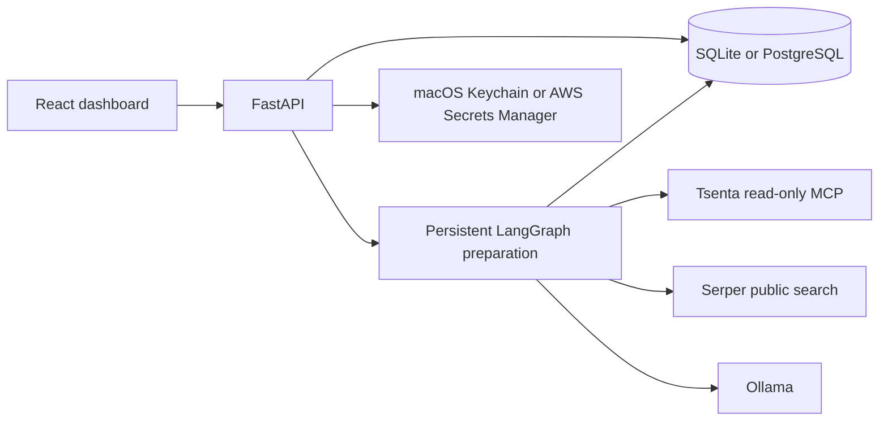

# Architecture and repository guide

Outreach is a single-workspace application that reads Tsenta application history,
researches possible contacts, and prepares drafts grounded in approved experience.
Users review, copy, and send messages themselves; the app records manually reported
outreach activity. It does not send LinkedIn invitations or messages or read an inbox.

## Components

- `frontend/src/`: dashboard, application and contact review, approved experience,
  settings, draft suggestions, and manual outreach tracking. API requests use the
  local bootstrap token or remote authenticated session and CSRF protection.
- `backend/main.py`: app factory, HTTP routes, startup coordination, host/origin
  validation, onboarding, and frontend serving.
- `backend/store.py`, `details.py`, `upgrades.py`: SQLite ledger, additive migrations,
  provenance/backfills, and immutable baseline membership. Saved edits and historical
  activity survive sync and migration.
- `backend/postgres_store.py`, `schema.py`, `migrations/`: optional PostgreSQL/pgvector
  storage and frozen Alembic migrations. Runtime SQLite migration is separate.
- `backend/engine.py`, `preparation.py`: single-worker scheduling, persistent graph
  checkpoints, bounded retries, review pauses, and explicit resume behavior.
- `backend/tsenta.py`: OAuth/PKCE, credential refresh, and complete read-only snapshots.
  Shared MCP transport and snapshot validation currently live in
  `scripts/inspect_tsenta.py` and `scripts/tsenta_baseline.py`; both are runtime dependencies.
- `backend/research.py`, `contact_evidence.py`, `posting_role.py`: bounded provider
  reads, source validation, contact assessment, and posting-based role extraction.
- `backend/experience.py`, `matching.py`, `skill_evidence.py`: versioned approved
  experience, retrieval, exact source-span extraction, and conservative requirement
  assessment. Similarity and tags alone do not establish a qualification.
- `backend/note_renderer.py`, `personalization.py`, `input_budget.py`: fact selection,
  deterministic whole-fact rendering, input budgets, and separately reviewable
  suggestions. Generated suggestions do not silently replace edited drafts.
- `backend/outreach.py`, `maintenance.py`, `quality.py`: manual activity, follow-up
  state, guarded note repair, and operational summaries.
- `backend/security.py`, `auth.py`, `observability.py`: credential providers, URL
  validation, optional remote sessions/roles, and opt-in redacted Langfuse exports.
- `backend/demo.py`: fictional providers/data for the demo and isolated tests.

## State and safety boundaries

Local data is stored under ignored `.local/`. The ledger and its
`.checkpoints.sqlite` sidecar are distinct durable stores and must be backed up
and restored together. The launcher uses Unix process locking; operate one worker
per workspace, including when moving between a local and cloud host.

New live workspaces connect Tsenta and import complete initial history in Settings.
Existing baseline membership is immutable. Startup requests one sync; recurring
external polling stays off unless a supported interval and reference are configured.
Missing-role extraction is independent of contact research.

Model outputs are validated as structured data. The model selects approved fact IDs;
the renderer uses whole approved facts rather than accepting arbitrary generated
experience claims. Unknown source details and unsupported qualifications stay visible
for user review. Search snippets do not prove hiring ownership.

Credentials are stored separately from the database. Local mode uses native macOS
Keychain; the optional AWS provider uses a dedicated Secrets Manager secret and
instance permissions. Raw tracing is off. Demo and browser tests use fictional
credentials and temporary databases.

## Deployment and verification

The default dashboard binds to localhost. Public remote operation requires HTTPS,
authentication, signed sessions, CSRF, role checks, and host/origin allowlists. The
verified AWS deployment used a private Session Manager tunnel instead of public
access, and was removed after testing to conserve Free Plan credits.

- [Setup, backup/restore, migration and rollback](operations.md)
- [Evaluation protocol and limitations](evaluation.md)
- [Verification results and remaining boundaries](verification.md)
- [AWS deployment guide](private-aws.md)
- [Verified AWS deployment and cleanup](aws-deployment-verification.md)
- [Fictional desktop/mobile screenshot gallery](screenshots/README.md)

## Repository artifacts

Keep app source, tests, migrations, synthetic evaluation inputs, dependency
manifests/locks, deployment source, and curated documentation/screenshots in Git.
Generated benchmark reports, project-specific AWS templates, test screenshots,
local databases, credentials, dependency installs, and build output stay ignored.
Normal browser tests write to test artifacts; `npm run screenshots:update` explicitly
refreshes the published fictional gallery.
