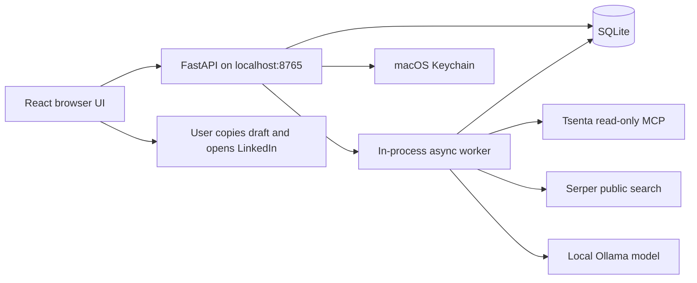
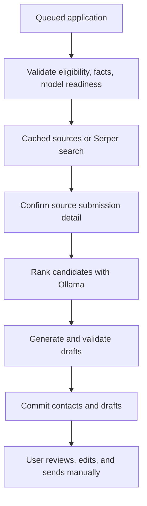

# Repository and architecture guide

This guide describes the code inspected on September 20, 2026. Groq, Tavily, Supabase, and Render were discussed as future possibilities; they are not the current implementation.

## 1. Purpose and architecture

Outreach is a single-user local assistant for an applicant. Tsenta supplies application submission status. Outreach imports that history, finds possible contacts, prepares drafts grounded in approved personal facts, and records outreach activity that the user reports manually.

It does not submit job applications, send LinkedIn invitations/messages, read a LinkedIn inbox, or automatically detect replies. Copying text and opening a profile do not count as sending.



The browser polls the local API every five seconds while visible. That is separate from external Tsenta synchronization, which is manual unless explicitly configured. Browser polling does not make a Tsenta request every five seconds.

## 2. Repository map

```text
auto-outreach-system/
├── README.md                    Shareable setup and overview
├── requirements.txt             Python dependency ranges
├── .env.example                 Nonsecret configuration template
├── .gitignore                   Private/generated file exclusions
├── backend/
│   ├── main.py                  App factory, schemas, routes, UI serving
│   ├── store.py                 SQLite access, initial migration, sync ingestion
│   ├── details.py               Later migrations, provenance, metadata mapping
│   ├── engine.py                Research/sync orchestration and retries
│   ├── tsenta.py                OAuth, refresh, MCP reads, full snapshots
│   ├── research.py              Serper, Ollama ranking/drafting, validators
│   ├── contact_evidence.py      Source-based title extraction/relevance rules
│   ├── outreach.py              Manual event log and conversation state
│   ├── security.py              Keychain, URL rules, error categories
│   ├── demo.py                  Fictional data and provider implementations
│   └── __init__.py              Python package marker
├── frontend/
│   ├── index.html               Browser entry, title, favicon reference
│   ├── public/favicon.svg       White Outreach brand mark
│   ├── package.json             Dependencies and scripts
│   ├── package-lock.json        Resolved npm dependency tree
│   ├── vite.config.ts          React/Tailwind plugins and dev API proxy
│   ├── tsconfig.json            Strict TS config; JS helpers allowed
│   ├── src/
│   │   ├── main.tsx             React mounting, API helper, Settings screen
│   │   ├── Workspace.tsx        Navigation, tables, queue, tracker, dialogs
│   │   ├── DraftDialog.tsx      Editing, suggestions, copy/profile actions
│   │   ├── workflow.mjs         Filtering, sorting, grouping, state helpers
│   │   ├── actions.mjs          Clipboard and LinkedIn URL/opening helpers
│   │   └── style.css           Layout and visual styling
│   └── tests/                  Node tests
├── scripts/
│   ├── run.py                  Single-process localhost launcher
│   ├── inspect_tsenta.py       OAuth diagnostic/shared MCP HTTP transport
│   ├── tsenta_baseline.py      Snapshot validation/initial baseline writer
│   └── check_local_model.py    Real Ollama check using fictional inputs
├── tests/                      Python unit/API tests
└── docs/architecture.md         This guide
```

Local-only directories: `.local/` holds private databases, backups, and captures; `.venv/` contains Python packages; `frontend/node_modules/` contains npm packages; `frontend/dist/` contains the production build. Caches and account-specific historical review documents are also excluded from Git. Historical reviews are not current architecture specifications.

## 3. Technologies and their roles

| Technology | Actual role |
| --- | --- |
| React 19 | Screens, component state, effects, dialogs. |
| TypeScript | Build-time checks; strict mode is enabled, although UI data still frequently uses `any`. |
| Vite 6 | Development server, API proxy, production bundling. |
| CSS / Tailwind integration | Custom CSS provides most styling; Tailwind is integrated into the build. |
| Lucide React | Interface icons; the Outreach logo is a separate SVG. |
| FastAPI | HTTP API, input parsing, response handling, application lifecycle. |
| Uvicorn | ASGI server running FastAPI on localhost. |
| Pydantic 2 | Request and structured model-output validation. |
| SQLite / `sqlite3` | Relational persistence with explicit SQL/transactions; no ORM. |
| `asyncio` | Background loop and asynchronous provider calls. No Celery or Redis. |
| HTTPX | Async Serper and Ollama calls. |
| Standard-library `urllib` | Restricted-origin Tsenta/OAuth transport and SSE parsing. |
| `keyring` | Explicit macOS Keychain backend; no plaintext fallback. |
| `python-dotenv` | Loads local environment configuration. |
| pytest / TestClient | Backend tests against fictional providers and temporary databases. |
| Node `node:test` | Frontend helper and selected interaction-contract tests. |

There is no Next.js, Express, hosted database, queue broker, agent framework, or public-user login system. npm dependencies have a lockfile; Python dependencies currently use version ranges without a resolved lockfile.

## 4. Startup and browser requests

1. `run.py` adds the project root to Python's import path, loads `.env`, sets restrictive file creation permissions, and ensures `.local/` exists.
2. It acquires `app.lock` or `demo.lock` to prevent duplicate instances of that mode.
3. Uvicorn starts the `backend.main:create_app` factory on `127.0.0.1:8765` with one worker and access logs disabled.
4. Demo mode seeds fictional history. Live mode requires an existing validated baseline and refuses to silently replace it.
5. Initialization migrates the database, restores recoverable job states, and fills certain missing metadata from saved evidence.
6. The factory creates Keychain, Tsenta, Serper, and Ollama adapters, or their demo substitutes.
7. FastAPI's lifespan starts the engine loop and cancels it during shutdown.
8. FastAPI serves `frontend/dist`. During development, Vite serves port 5173 and proxies `/api` to FastAPI.
9. The frontend calls `/api/bootstrap` and sends the returned process token as `X-Outreach-Token` on later API requests. It fetches state/settings and periodically refreshes visible local state.

Navigation is component state, not a routing library. Filters and collapsed groups persist in session storage. Business records persist in SQLite.

## 5. Tsenta OAuth and synchronization

`tsenta.py` validates OAuth discovery metadata, dynamically registers a client, and uses authorization-code OAuth with S256 PKCE and random state. Pending sign-in data stays in memory and expires after ten minutes. The callback is hardcoded to localhost. Tokens are saved to Keychain and refreshed near expiration when a refresh token is available.

The MCP adapter initializes a protocol/session and uses JSON-RPC `tools/call`. Application list/status reads are allowlisted; job-detail reads have separate argument validation. The app does not permit arbitrary MCP calls or application submission operations.

Sync applications enqueues a persistent `sync_runs` row; a unique index prevents duplicate active syncs. The worker prioritizes sync over research:

1. Read all source history, up to 100 records per page.
2. Check envelopes, page counts, stable totals, unique IDs, and submitted-count consistency.
3. Apply the validated snapshot in one transaction.
4. Save observed/added/eligible counts and completion state.

Only exact `COMPLETED` means confirmed submitted. Source status and manually recorded hiring outcome are distinct: rejection does not erase submission history.

`createdAt`, `updatedAt`, local `first_seen`, and `submitted_at` are separate fields. Missing submission timestamps stay missing. The default UI selects completed records and sorts `source_created_at` descending, labeled Tsenta order. This matched the complete live submitted ordering during September 19 verification; it is timestamp-based, not a persisted source rank or guaranteed future sorting contract.

Ingestion inserts/updates records but does not remove records absent from later snapshots. Deletion reconciliation is not implemented. Sync rereads full history; there is no incremental cursor or webhook integration.

## 6. Historical baseline

The baseline records applications present when the assistant was introduced. `baseline_members` preserves their IDs; triggers prevent update/delete of baseline metadata and membership. Validation checks membership count, missing applications, and historical flags.

- Already-completed baseline applications require explicit selection before research.
- Baseline applications not yet submitted can qualify when subsequently confirmed completed.
- New completed applications can be queued for research during sync.
- Non-completed source records and rejected/closed applications cannot start ordinary new research.

The purpose is to avoid preparing outreach for the entire old history on import. None of these rules sends messages.

## 7. Research and drafting

The in-process engine handles one research job at a time. Persistent jobs/progress stages drive the UI. A research attempt has a ten-minute outer timeout.



### Search and evidence

Serper receives one search containing company, role, recruiting/hiring terms, and `site:linkedin.com/in/`. It requests ten results and accepts up to six deduplicated valid profile URLs with snippets. Text sizes are bounded and source IDs derive from URL hashes. Sources are cached per application for retries.

Company/role terms go to Serper; approved experience goes to local Ollama. There is no authenticated LinkedIn scraping. A snippet may be incomplete, stale, or unrelated to the target employer.

The ranking schema allows at most five candidates. Chosen IDs must exist, names must appear in source text, and evidence quotes must match. URLs remain server-controlled. Unsupported titles/companies are cleared; conservative extraction may fill missing titles.

`contact_evidence.py` separately assigns high/medium/low/unassessed relevance using employer association, supported title, recruiting/leadership terms, and role-domain overlap. This is a heuristic, not a probability or proof of hiring responsibility. Low relevance is displayed but is not currently a hard drafting exclusion.

### Model configuration and message validation

The default model is `qwen3:4b`, configurable through `OLLAMA_MODEL`, at fixed localhost port 11434. Calls request JSON schemas with thinking/streaming disabled, 4,096 context tokens, bounded output, and low temperature. A lock serializes calls. Oversized encoded inputs are rejected; source/fact inputs are explicitly bounded.

Settings stores up to twelve approved facts of at most 300 characters each, identified by hashes. The model selects relevant IDs and framing; unknown IDs fail validation.

Generated connection notes currently require exactly 200 Unicode characters, the recipient first name, exact application company/role, an application statement, at least one verbatim approved fact, normal spacing, and a complete sentence. There are four revision attempts with measured length and validation feedback. Failure preserves the saved draft.

DMs combine a deterministic opening, complete selected facts, and a question. Whole facts are removed to fit the DM limit rather than truncating claims.

The Settings API accepts a `note_limit`, but generated notes currently hardcode 200. Manually edited notes follow different validation and may exceed that target. This inconsistency is an implementation detail, not a claim about external LinkedIn limits.

Contacts and drafts publish transactionally after another eligibility check. `INSERT OR IGNORE` preserves existing edits during retries. Editor suggestions return for review and do not immediately overwrite saved text.

### Failures and recovery

`Unavailable` blocks work for configuration/authorization issues. `Retryable` schedules exponential backoff starting at 30 seconds, optionally respecting a provider delay. Ordinary jobs stop after three attempts. Startup marks interrupted research for manual retry and resumes interrupted sync through retry state. Sources are cached, but every intermediate model result is not checkpointed.

## 8. SQLite schema

| Table | Responsibility |
| --- | --- |
| `baseline` | Singleton import metadata, count, and fingerprint. |
| `baseline_members` | Immutable historical membership IDs. |
| `applications` | Tsenta ID primary key; source status/dates, company/role, research state, outcomes, metadata. |
| `settings` | Singleton JSON facts/limits document. |
| `sync_runs` | Sync queue/history, retry timing, counts, errors. |
| `jobs` | One research job per application; state/stage/attempts. |
| `research_cache` | Source snippets per application. |
| `contacts` | Candidate identity, profile, evidence, review/correction state. |
| `drafts` | One connection note/DM/grounding record per contact. |
| `outreach_events` | Manual events, deduplication IDs, optional undo timestamps. |

An application has many contacts. Each contact has one draft pair and many events. JSON columns hold evidence, grounding, facts, and locations. Access uses explicit SQL, foreign keys, timeout, and a commit/rollback context manager. Schema changes use SQLite `PRAGMA user_version` and private backup files rather than Alembic.

## 9. Frontend and manual conversation state

- **Applications:** search, status filters, Tsenta sorting, 25-row pagination, application details, research/retry progress, manual hiring outcome.
- **Outreach queue:** company/application grouping, contact search, evidence/relevance, dismiss/restore, review/edit/draft dialogs.
- **Outreach tracker:** manually recorded invitations/messages/replies, activity filters, event history, undo corrections.
- **Settings:** source connection, search key, approved facts, draft limits, model readiness, polling configuration explanation.

`workflow.mjs` houses reusable filtering/grouping/conversation helpers. `actions.mjs` validates links and reports clipboard and popup success separately. Neither helper records a sent event.

Conversation state derives from non-undone events. A DM/follow-up suggests another follow-up after seven days unless a reply, rejection, closure, or closed hiring outcome stops it. This is a reminder, not a sending schedule. Unique request IDs prevent duplicate events. Undo retains history; dependent follow-ups must be undone before undoing their original DM.

## 10. API responsibilities

| Route | Action |
| --- | --- |
| `GET /api/bootstrap` | Process token and demo flag. |
| `GET /api/state` | Application/contact snapshot, conversation and sync state. |
| `GET/POST /api/settings` | Read health/settings or save approved facts/limits. |
| `POST/DELETE /api/settings/search-key` | Save/remove vault credential. |
| `POST /api/tsenta/connect` | Start OAuth. |
| `GET /api/tsenta/callback` | Complete OAuth and queue sync. |
| `DELETE /api/tsenta/connection` | Remove local credentials. |
| `POST /api/sync` | Deduplicated sync request. |
| `POST /api/applications/{aid}/research` | Select/queue eligible application. |
| `PUT /api/applications/{aid}/outcome` | Save manual hiring outcome. |
| `POST /api/applications/{aid}/details` | Attempt metadata/posting lookup. |
| `PUT /api/contacts/{cid}` | Correct, review, dismiss contact. |
| `PUT /api/contacts/{cid}/drafts` | Save manual edits. |
| `POST /api/contacts/{cid}/draft-suggestion` | Return unsaved generated suggestion. |
| `GET /api/contacts/{cid}/prepare` | Return validated URL/text; does not send. |
| `POST /api/contacts/{cid}/events` | Record manual activity. |
| `POST /api/contacts/{cid}/events/{eid}/undo` | Mark an event undone. |
| `PUT /api/contacts/{cid}/connection` | Manually update connection state. |
| `POST /api/demo/transition` | Advance fictional workflow, demo only. |

## 11. Security and hosting boundaries

The protection model depends on localhost. Host/origin allowlists, a process token, URL validation, headers, request limits, and disabled access logs operate within that design. `/api/bootstrap` gives the token to allowed local callers; this is not user authentication or a public login system.

Keychain stores live tokens/search credentials. SQLite stores private application records, approved experience, contacts, drafts, and events. File permissions are restrictive, but this is not database encryption or a complete security audit.

Tsenta requests reject unexpected origins and redirects. Profile links must be HTTPS LinkedIn `/in/` URLs. Prompts treat supplied content as untrusted data; structured output/source/fact checks reduce but do not eliminate model error or prompt injection.

Public hosting needs real authentication/authorization, hosted secret storage, a verified hosted Tsenta callback, durable database storage, a suitable worker lifecycle, public-origin configuration, and a reachable model provider. Multiple users also require ownership/isolation across queries and jobs. Uploading to GitHub does not deploy this dynamic application.

## 12. Test map

| File | Focus |
| --- | --- |
| `tests/test_baseline.py` | Snapshot integrity, conservative status mapping, baseline idempotence. |
| `tests/test_inspection.py` | Read allowlists and HTTP restrictions. |
| `tests/test_workflow.py` | Fictional API workflow, research, events, local protection. |
| `tests/test_serper.py` | Search parsing, URL filtering, deduplication, errors. |
| `tests/test_ui_redesign.py` | Baseline/provenance and redesign contracts. |
| `tests/test_improvements.py` | Grounding/length, editing, metadata regressions. |
| `tests/test_contact_evidence.py` | Source title extraction and relevance. |
| `frontend/tests/actions.test.mjs` | Profile URLs, clipboard/popup failures, manual text. |
| `frontend/tests/workflow.test.mjs` | Filtering, source sorting, progress notifications. |
| `frontend/tests/redesign.test.mjs` | Defaults, grouping, tracker state, relevance sorting. |

Backend tests use temporary storage and fictional providers. They do not demonstrate live OAuth refresh, provider availability, or real hiring relevance. Node tests cover logic and selected source contracts rather than full browser automation. The build runs TypeScript and Vite. `check_local_model.py` is an optional real Ollama check using fictional inputs.

## 13. Current limits and next improvements

1. Fresh clones can run the demo, but initial live baseline creation is not a complete onboarding wizard.
2. Posting lookup intentionally does not map an unverified job-description response. Missing descriptions stay missing.
3. Search snippets/relevance rules cannot establish employment or ownership of an opening.
4. Exact 200-character notes can be impossible for long roles/companies/facts; validation then rejects generation.
5. Recurring source polling needs a supported interval/reference; no webhooks exist.
6. Full snapshots and one worker suit local use, but scale/multi-user hosting needs further design.
7. Python dependencies lack an exact lockfile. Frontend data still often uses `any`. `main.tsx` and `Workspace.tsx` have a circular import through shared API/settings helpers; extracting those would simplify maintenance.
8. Historical notes include already-fixed findings; current code/tests should determine current behavior.

## 14. Recommended reading order

Start with `run.py` and `main.py` for startup/routes, then `store.py` and `details.py` for persistence/historical protection. Follow `engine.py` into `tsenta.py` and `research.py` for provider calls. Read `outreach.py` for manual conversation state. Then read `Workspace.tsx`, `workflow.mjs`, `DraftDialog.tsx`, and `actions.mjs` to connect the API with the UI. Review each module's tests alongside it.
