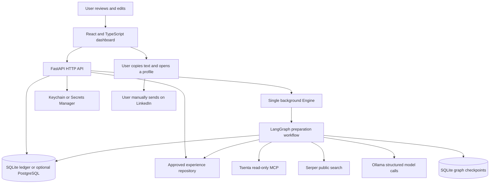

# Outreach: interview explanation and code walkthrough

This guide explains the current implementation, including its limitations. Start
with sections 1–3 for your introduction, use sections 4–13 for technical follow-up,
and rehearse the questions in section 16. Code links point to the actual repository.

## 1. The project in one sentence

> I built a single-user application that turns confirmed job applications into
> evidence-backed outreach drafts, with persistent workflows, approved experience,
> and human review before the user sends anything.

**The problem:** application history, job requirements, personal experience,
contact research, drafts, and follow-up notes are usually scattered across tools.
Repeatedly assembling that context is slow, and unrestricted AI generation can
invent qualifications or overwrite work the user has already edited.

**The solution:** one dashboard connects those steps while keeping the original
history, evidence, saved edits, and manual activity distinct.

Tsenta supplies job-application history. Serper supplies public search results.
Ollama runs the language and embedding models. This app owns the workflow,
validation, storage, review experience, and recovery behavior around them.

## 2. A 60–90 second opening pitch

> My project is an application-tracking and outreach-preparation assistant built
> with React and TypeScript on the frontend and FastAPI on the backend.
>
> It imports confirmed applications from Tsenta, retrieves relevant user-approved
> experience, researches possible contacts through public search, and uses a local
> Ollama model to rank evidence and select facts for drafts. The model does not get
> to invent experience: the final messages use whole approved facts and controlled
> framing, and the user reviews and sends them manually.
>
> The main engineering work was making the workflow reliable. I preserve an
> immutable initial baseline, use persistent LangGraph checkpoints to resume work,
> version evidence so stale suggestions cannot be accepted, and use database
> constraints to avoid duplicate contacts and activity records.
>
> I tested the backend, frontend, browser flows, recovery behavior, and database
> migration paths. I also deployed and verified it on AWS EC2 with encrypted EBS,
> Secrets Manager, and private Systems Manager access, then removed the deployment
> to conserve free credits.

If the interviewer asks about one part, stop the pitch and explain that part.
You do not need to list every library in your introduction.

## 3. The five-minute version

| Time | Explain | Main point |
|---|---|---|
| First minute | Problem and user workflow | One place to prepare grounded outreach; sending remains manual. |
| Second minute | Architecture and data | React → FastAPI → database and background worker; secrets stored separately. |
| Third minute | AI workflow | Extract requirements, retrieve approved evidence, research contacts, select facts, render and validate drafts. |
| Fourth minute | Reliability | Stable IDs, immutable baseline, checkpoints, version guards, idempotent persistence. |
| Fifth minute | Testing, AWS, tradeoffs | Explain verified behavior, temporary deployment, and what you would improve next. |

A useful transition is: “Let me trace what happens when a user clicks Prepare
outreach for one confirmed application.”

## 4. Architecture



### What runs where

- The React app runs in the browser. Vite builds it into static assets.
- FastAPI serves the API and built UI. Uvicorn runs one application process.
- An asynchronous `Engine` runs in that process and schedules work from durable
  database rows. This is not a separate Celery worker or a distributed task queue.
- SQLite is the default ledger. PostgreSQL/pgvector is an optional tested path.
- LangGraph saves execution state in a separate SQLite checkpoint file, including
  when the ledger is PostgreSQL.
- Ollama is a separate model service. Locally it runs on the Mac; the temporary
  AWS deployment ran it in another container on the EC2 host.
- Live application history and search still require network access. Local model
  inference does not make the entire application offline.

### Why these choices

| Choice | Reason | Tradeoff |
|---|---|---|
| React + TypeScript | Interactive review, clear data shapes, reusable dialogs and views. | Frontend build and state coordination add complexity. |
| FastAPI + Pydantic | Async provider calls and explicit request/model-output validation. | Validation still needs business rules beyond a schema. |
| SQLite by default | Simple deployment and durable storage for one user's workspace. | Not a distributed concurrency architecture. |
| PostgreSQL/SQLAlchemy/pgvector | Migration path and vector storage/query support. | Additional operations and adapter complexity. |
| LangGraph | Explicit stages, conditional routes, durable pauses and resumption. | Checkpoint lifecycle and input versioning must be managed. |
| Ollama | Model inference under the operator's control. | CPU/RAM requirements and latency; provider reliability remains a concern. |
| Controlled rendering | Preserve approved claims exactly. | Less stylistic flexibility; exact-length notes can be impossible. |
| One EC2 host for AWS verification | Simple deployment compatible with the existing single-worker design. | Single point of failure; no high-availability claim. |

## 5. Startup, onboarding, and synchronization

### Startup

Entry point: [`scripts/run.py`](../scripts/run.py).

1. Load environment configuration.
2. Create the local state directory with restrictive permissions.
3. Acquire a Unix file lock for the selected workspace mode.
4. Start Uvicorn with one worker and the `create_app` factory.

[`backend/main.py`](../backend/main.py), `create_app()`, selects the real or fictional
providers, the ledger implementation, the credential store, and the experience
repository. Existing databases are initialized/migrated. The lifespan handler
starts the worker and requests an initial sync for an initialized live workspace.

The lock protects the launcher on one machine. It is **not** a cross-host lock:
you must not run local and cloud workers against copies of the same live workspace
and assume they coordinate automatically.

### First import

A fresh live workspace opens Settings and connects Tsenta through OAuth/PKCE.
`POST /api/onboarding/initialize` then:

1. Reads the complete, unfiltered application history.
2. Validates pagination and stable IDs.
3. Builds the initial database at a temporary `.initializing` path.
4. Applies migrations and validates the baseline.
5. Publishes the initialized database using a hard link that refuses to overwrite
   an existing destination.

An asynchronous onboarding lock prevents overlapping initialization in the same
process. Existing baseline databases cannot be replaced through this route.

### Why the initial baseline matters

An initial import should not unexpectedly trigger outreach for every old
application. The app records original membership in `baseline_members` and marks
whether a historical application was already confirmed at import.

Already-confirmed historical applications require explicit selection for research.
An application observed later, or one that becomes confirmed later under the
eligibility rules, can qualify without moving the original cutoff.

> “I track stable membership rather than relying only on a last-seen timestamp.
> That preserves the initial boundary even after the app is offline for a while.”

SQL triggers prevent updates/deletions of baseline records; consistency checks
also guard synchronization and preparation. The number of baseline records is
workspace data, not a hardcoded product limit.

### Later syncs

Code: [`Store.enqueue_sync()` and `Store.apply_snapshot()`](../backend/store.py),
[`Tsenta.snapshot()`](../backend/tsenta.py), and [`Engine.tick()`](../backend/engine.py).

- A partial unique index allows one active sync row at a time.
- The worker reads a complete validated snapshot before applying it.
- Stable source application IDs identify records across runs.
- Source metadata is updated without replacing saved contact drafts or activity.
- Newly eligible applications can receive jobs when automatic research is enabled.
- A missing record in a later snapshot is not automatically treated as permission
  to delete the local application and its history.

The dashboard refreshes local API state every five seconds while visible. That
is distinct from calling Tsenta. Recurring Tsenta polling is disabled unless the
operator explicitly configures an interval and a support reference.

### OAuth and MCP in plain language

OAuth lets the user authorize Tsenta access without giving the app their password.
PKCE ties the authorization code to a secret verifier generated for that login;
`state` ties the callback to the initiating request.

MCP provides a structured tool interface. Here, the app calls allowlisted Tsenta
read tools over HTTP/JSON-RPC. It does **not** expose arbitrary tools for the model
to execute. The transport validates endpoints, bounds responses, and handles
provider errors. Tokens live in the credential store, including refreshed tokens.

## 6. One complete preparation request

Example: a confirmed application at **Fictional Cedar Labs** for **Backend Engineer**,
with this job-description passage:

```text
Build internal services using Python. PostgreSQL experience is preferred.
```

The user has approved:

```text
I built a Python service that processed internal reporting jobs.
```

### Step 1: Queue the work

The frontend calls `POST /api/applications/{aid}/research`.
`Store.select_application()` checks the baseline, confirmation status, and hiring
outcome, records explicit selection, and inserts or requeues the application's job.

The HTTP request does not wait for a full research/model workflow. The dashboard
shows job progress while the background worker processes it.

### Step 2: Claim and guard the job

`Engine.tick()` processes syncs first, then a due preparation job. The conditional
job update prevents a job from being claimed if its state has already changed.
`Engine.research()` checks eligibility again and invokes the preparation graph.

An outer ten-minute preparation timeout prevents an endless active state. Provider
requests also have their own timeouts. These are operational limits, not latency
or throughput guarantees.

### Step 3: Choose a versioned graph run

[`backend/preparation.py`](../backend/preparation.py) derives the run identity from
application ID and an input version. Inputs include description, role, company,
description version, a retry epoch, and the experience repository revision.

Same inputs can resume their existing checkpoint. Changed inputs create a different
run identity. Each node checks that current inputs still match before continuing.

### Step 4: Extract requirements

[`backend/matching.py`](../backend/matching.py), `extract()`, splits the description
into exact source spans. The model returns requirement text, category, priority,
and a zero-based `source_index`. The server obtains the excerpt from that index.

Validation rejects invalid indexes, excerpts absent from the original description,
and named technologies absent from their cited passage. Invalid structured output
gets at most one corrective extraction retry before it propagates.

The narrow “using Python” skill may be represented separately from a broader
responsibility. Evidence of using Python must not automatically establish every
duty, scale, or duration described in the same sentence.

If there is no description, the graph takes a clearly labeled role-based fallback.
It does not invent a job description.

### Step 5: Retrieve and assess approved experience

[`backend/experience.py`](../backend/experience.py), `retrieve()`:

1. Filters to approved records **before** scoring.
2. Uses lexical token overlap for small collections.
3. Uses embeddings when the configured threshold is reached (default 50 approved
   records), or when a real evaluation explicitly forces embeddings.
4. Reuses compatible cached embeddings, checking model identity and dimensions.
5. Falls back to lexical retrieval with a warning if embedding work fails.
6. Rechecks current approval, content hash, and version after provider work.
7. Returns at most six facts with a combined 2,800-character fact-text budget.

The default embedding model is `nomic-embed-text`. SQLite uses Python cosine
similarity; PostgreSQL can order compatible vectors using pgvector cosine distance.
This implementation is not an optimized large-corpus ANN search service.

`match()` then applies conservative evidence rules:

| Assessment | Meaning |
|---|---|
| Supported | Approved factual text provides the required explicit evidence. |
| Uncertain | Related evidence exists, but scope, duration, or other detail needs review. |
| Unsupported | The approved collection supplies no sufficient supporting evidence. |

In the example, the Python fact can support the Python skill. It does not establish
PostgreSQL expertise. Technology tags help find records; they do not independently
prove the factual claim. Unsupported means **missing evidence in this collection**,
not proof the user lacks the qualification.

If no approved supporting facts remain, preparation pauses rather than generating
an unsupported draft.

### Step 6: Research and assess contacts

[`Serper.search()`](../backend/research.py) builds a bounded company/role search for
public LinkedIn profile results. URLs and snippets are validated and deduplicated.
Results are cached per application for retry reuse.

The workflow also checks application details with Tsenta when needed to reconfirm
submission. The model ranks a bounded set of sources using structured `Pick`
outputs. Names and evidence quotes are checked against source material; the server
retains the actual source URL instead of trusting a generated replacement.

[`backend/contact_evidence.py`](../backend/contact_evidence.py) assesses visible
role/company evidence. The preparation graph accepts high/medium assessments.
A low or unassessed contact should not be presented as a verified hiring owner.
No accepted contacts routes to a completed no-contact result rather than inventing
someone to fill the UI.

### Step 7: Select facts and render drafts

[`backend/personalization.py`](../backend/personalization.py) can refine retrieval
using the contact title, then asks `Ollama.draft()` for a structured `DraftPlan`.
The plan selects approved fact IDs and permitted framing choices.

The model does **not** return unrestricted final experience claims.
[`backend/note_renderer.py`](../backend/note_renderer.py) combines:

- An application introduction using the actual role/company.
- Whole approved fact sentences.
- Controlled connection-request framing.

The default generated note setting requires exactly **200 Unicode code points**.
The renderer searches combinations of approved facts and framing to meet that
constraint. It does not chop a fact mid-sentence or pad it with whitespace.
If no valid combination exists, it returns a useful failure and keeps previous
saved work. Disabling exact-length generation permits shorter valid notes.

The direct message retains whole selected facts within its configured length limit
(default 1,200). Facts are removed whole if needed rather than shortened into
misleading fragments. Prompt-size checks also bound model input: the drafting
budget uses serialized characters (6,500 for user data and a configurable 14,000
for the full payload), not a tokenizer-based proof that the context will fit.
The Ollama request separately configures a 4,096-token context and up to 1,100
predicted tokens, with structured JSON output, `think:false`, and temperature 0.1.
Truncated or invalid output is rejected. Character and token limits are different
constraints, so this conservative budget still has limitations.

### Step 8: Validate and persist

The graph rechecks approval and selected IDs for new drafts, rejects empty output,
and checks eligibility again at persistence. Contacts are unique by application
and source key. Draft insertion uses `INSERT OR IGNORE`, preserving existing
reviewed drafts rather than silently replacing them during retries.

A simplified normal path is:

```text
queue → requirements → experience retrieval → contact research
      → evidence assessment → drafting → validation → review → persistence
```

This is a simplified explanation, not a replacement for the graph's conditional
branches, failure pauses, or version checks.

## 7. Persistent workflows and failure recovery

The scheduler and the graph solve different problems:

| Layer | Responsibility | Durable location |
|---|---|---|
| Engine | Which queued/retry job should run next? | `jobs`, `sync_runs` in the ledger |
| LangGraph | Which preparation stage has completed or paused? | `.checkpoints.sqlite` sidecar |
| UI | What progress/action should the user see? | API projection of ledger and graph status |

Graph nodes use `interrupt()` to save a pause for invalid output, missing evidence,
provider failures, or an optional pre-persistence review. Explicit resumption uses
`Command(resume=True)`. Missing evidence requires changing approved input, not just
clicking through a warning.

For errors handled by the scheduler, unavailable configuration blocks work;
retryable errors use bounded attempts and exponential delays, honoring a larger
provider-supplied retry delay where applicable. Graph-stage provider errors may
instead pause for review/resume. Do not describe every failure as an automatic
background retry.

On restart, running work is marked interrupted. Recovery consults checkpoint/run
information and restores eligible scheduling state. Persisted sources and graph
state allow resumption without blindly repeating every completed step.

> “The scheduler tracks work availability; the graph owns stage progress. I keep
> both durable, but I do not claim a transaction spans the ledger, graph checkpoint,
> and external services.”

Repeated external reads/model calls can still happen around failures. Constraints
and guarded inserts make repeated persistence safe for the supported workflow;
this is not distributed exactly-once execution.

## 8. Data model and evidence versioning

| Tables | Purpose |
|---|---|
| `baseline`, `baseline_members` | Immutable initial import and original membership. |
| `applications` | Stable source ID, submission state, selected/research state, provenance and outcome. |
| `sync_runs`, `jobs` | Scheduling, attempts, next attempt, errors and progress. |
| `contacts`, `research_cache` | Saved source-backed contacts and cached search results. |
| `drafts` | Current saved note/DM and grounding; one saved draft pair per contact. |
| `descriptions`, `match_reviews` | Versioned descriptions and requirement/evidence assessments. |
| `experience` | Approved/draft/retired facts, provenance, versions, hashes and optional vector caches. |
| `preparation_runs`, `preparation_epochs`, `preparation_resume_requests` | Run identity and explicit retry/resume coordination. |
| `draft_suggestions`, `message_feedback` | Proposed replacements and per-message acceptance/edit feedback. |
| `outreach_events` | User-reported activity with idempotent request IDs and undo state. |
| `posting_roles`, `posting_role_checks` | Extracted role provenance and attempted posting reads. |
| `settings`, migration bookkeeping | User preferences and schema evolution. |

Migration history can leave older compatibility tables in existing databases.
The presence of a historical table does not mean its corresponding feature is
currently exposed. Frozen migration input is intentionally kept in Git.

### Why version both experience and descriptions?

An approved record has a version and content hash. Editing an approved fact's
substantive content resets it to draft so that the persisted revision needs
approval. A suggestion records experience versions and description version/hash.

`validate_acceptance()` checks those inputs before accepting a generated suggestion.
If a fact was edited/retired or the job description changed, the UI must regenerate
instead of applying stale evidence. Manual editing remains available.

There are checks both after external generation and at acceptance because another
request may change evidence while the model is working or while the user is reading.
These are targeted optimistic guards, not universal serializable isolation.

### Why preserve suggestions separately?

Generating a better draft must not overwrite a message the user carefully edited.
Suggestions are saved separately and applied explicitly. Note and DM acceptance are
tracked separately, so applying only a note does not count the untouched DM as edited.
This feedback measures user interaction, not whether the message achieved an outcome.

## 9. Frontend and API walkthrough

| UI area | Main implementation | User behavior |
|---|---|---|
| Applications | [`Workspace.tsx`](../frontend/src/Workspace.tsx), [`workflow.mjs`](../frontend/src/workflow.mjs) | Search/filter/paginate, sync, inspect details, start or resume preparation. |
| Outreach queue | Same workspace and pure workflow helpers | Group saved contacts/drafts; review relevance and preparation results. |
| Outreach tracker | Workspace + event API | Show only actual manually recorded activity, timelines, replies and follow-up state. |
| Experience | [`Personalization.tsx`](../frontend/src/Personalization.tsx) | Add, edit, approve and retire evidence; review descriptions/matches. |
| Draft review | [`DraftDialog.tsx`](../frontend/src/DraftDialog.tsx) | Edit saved messages, generate/reject/apply suggestions, copy text, open profiles. |
| Settings | [`SettingsView.tsx`](../frontend/src/SettingsView.tsx) | Provider setup, import readiness, model availability, configuration. |
| HTTP client | [`api.ts`](../frontend/src/api.ts) | Bootstrap token, common errors, state cache and ETag revalidation. |
| Copy/open helpers | [`actions.mjs`](../frontend/src/actions.mjs) | Validate HTTPS LinkedIn URLs and report clipboard/popup outcomes separately. |

Important API groups in [`backend/main.py`](../backend/main.py):

```text
GET  /api/bootstrap                         establish API/session token
GET  /api/state                             dashboard snapshot
POST /api/tsenta/connect                     start provider authorization
POST /api/onboarding/initialize              import initial complete history
POST /api/sync                              request synchronization
POST /api/applications/{aid}/research        queue/retry preparation
GET  /api/applications/{aid}/preparation     inspect graph progress/pause
POST /api/applications/{aid}/preparation/resume
PUT  /api/applications/{aid}/description     version a description
POST /api/applications/{aid}/matches         assess approved evidence
GET/POST/PUT /api/experience...              manage approved facts
POST /api/contacts/{cid}/draft-suggestion    save a separate suggestion
PUT  /api/contacts/{cid}/drafts              save edits/accept selected suggestion parts
POST /api/contacts/{cid}/events              record manual activity
POST /api/contacts/{cid}/events/{eid}/undo   undo reported activity
GET  /health                               process health
GET  /ready                                ledger readiness
```

`/ready` is not an end-to-end provider check. A healthy ledger does not prove that
Tsenta, search, or the model is available.

The client avoids overlapping refresh requests and tracks action-specific pending
state. Tests also cover stale description responses and preventing acceptance of
outdated suggestions. Pure helper tests cover filtering, sorting and activity state;
browser tests exercise the actual components and API interactions.

## 10. Manual outreach, follow-up, and posting extraction

### Manual outreach

[`backend/outreach.py`](../backend/outreach.py) derives conversation state from
non-undone events and the application's hiring outcome. Activity uses unique
request IDs to avoid counting a repeated request twice.

Copying text or opening a profile is **not** a sent event. The user records an
invitation/message after taking that action themselves. Follow-up suggestions
become due seven days after the last recorded DM/follow-up unless a reply or closed
outcome suppresses them. No background sender executes those suggestions.

### Filling missing roles

[`backend/posting_role.py`](../backend/posting_role.py) reads public posting HTML,
tries `JobPosting` structured data and then an unambiguous heading, and retains
source/method/timestamp information. A structured-data title can be saved
conditionally by the background path; heading candidates require review.

Posting reads validate HTTPS/public addressing, bound redirects/body size/time,
and reject unsuitable pages. They do not bypass logins or execute arbitrary page
JavaScript. Automatic checks record attempts so unavailable pages are not repeatedly
fetched on every restart. Manual entry remains the fallback.

## 11. Security and privacy

| Boundary | Implemented protection | Limit |
|---|---|---|
| Local dashboard | Loopback default, host/origin checks, bootstrap token for protected APIs. | Local mode is not internet-facing authentication. |
| Optional remote mode | Scrypt password verification, signed secure sessions, operator/reader roles, CSRF checks, explicit HTTPS/host/origin settings. | Custom app authentication is not enterprise SSO/MFA. |
| Provider authorization | OAuth state/PKCE, validated discovery/endpoints, credential storage and refresh. | New remote callback configurations still need provider verification. |
| Model output | Pydantic schemas, exact-source checks, approved IDs, controlled rendering, stale-input guards. | Does not mathematically prove every inference or contact claim true. |
| Posting fetches | Public URL/address checks and bounded reads/redirects. | Public content is still untrusted. |
| Secrets | Native Keychain or scoped Secrets Manager access; excluded from Git/images. | The operator still manages provider access and rotation. |
| Observability | Opt-in Langfuse with operational metadata by default. | Enabling raw tracing explicitly can export facts/sources; not verified as a live service here. |

Search and Tsenta necessarily receive their request context. Local model hosting
reduces one data-sharing boundary; it does not eliminate external data disclosure.

## 12. PostgreSQL, migrations, and backup/restore

SQLite migrations are additive and create pre-migration backups. PostgreSQL uses
Alembic and a validated import path in
[`scripts/migrate_database.py`](../scripts/migrate_database.py).

[`backend/postgres_store.py`](../backend/postgres_store.py) adapts the existing
Store interface through SQLAlchemy. It translates the supported placeholder/upsert
patterns and preserves the row-access contract. This minimizes rewrite cost, but
it is a narrow compatibility layer, not a general SQLite-to-PostgreSQL SQL engine.
As query complexity grows, native SQLAlchemy statements would be easier to maintain.

The ledger and graph checkpoints are separate durable stores. A consistent backup
requires pausing the worker and preserving both. A copied file is not enough proof:
restore into a separate location and compare integrity, baseline and row contents.
The documented checks include real PostgreSQL dump/restore and offline SQLite ledger
plus checkpoint restore verification.

## 13. AWS deployment: what actually happened

> I deployed and tested a private single-host version on AWS, then tore it down.
> It is not currently running as a public hosted service.

CloudFormation created an Amazon Linux 2023 `m7i-flex.large` EC2 host in `us-east-2`,
with a 40 GiB encrypted gp3 EBS disk, instance permissions, a private release bucket,
and a Secrets Manager secret. App and Ollama ran as separate Docker containers.

The release archive's SHA-256 was checked before building the image on the host.
The app bound only to host loopback; the model port was not published. The security
group had no inbound rules. IAM-authorized Systems Manager port forwarding provided
browser access without opening SSH or a public application port. The host still
had outbound networking and a public IP for that access; it was not a private-subnet
NAT deployment.

Secrets were copied privately from Keychain to Secrets Manager. The instance role
could read release objects and read/update only its dedicated provider secret, plus
Systems Manager permissions. IMDSv2 was required, with hop limit 2 for containers.

Verified on AWS:

- Health, ledger readiness and the browser dashboard through the private tunnel.
- Live Tsenta history and one public Serper query.
- Real `qwen3:4b` fictional ranking and validated draft generation.
- Preservation of baseline, saved drafts and activity.
- Offline restore of ledger/checkpoints and readiness after restart.

`nomic-embed-text` was installed on AWS; a separate AWS embedding-inference test was
not performed. Public HTTPS and new remote OAuth reconnect were not verified.

The project stayed on the Free Plan. After verification, the instance, bucket
versions, secret, stack resources and retained disk were removed. Credits/billing
reporting can lag; do not claim an audited exact cost of zero merely because the
credit API initially still showed $100.

Deployment source: [`infra/aws/`](../infra/aws/README.md).
Evidence: [`aws-deployment-verification.md`](aws-deployment-verification.md).

## 14. Testing and what the numbers mean

| Layer | Most recent verified result | What it establishes |
|---|---|---|
| Python backend | 130 passed, 1 PostgreSQL skip in ordinary local run | API/business rules, preservation, extraction, recovery and other covered behavior. |
| Frontend helpers | 23 passed | Pure filtering, sorting, action and state logic. |
| Build | TypeScript and Vite passed | Type checking and production bundle construction. |
| Browser | 11 passed | Review flows, auth, failure/resume behavior, stale responses, setup and responsive layouts. |
| Mock evaluation | 50 cases, both methods, no harness failures | Controlled synthetic selection and evaluation-harness behavior. |
| Real-model smoke | Documented three-case model/embedding run | Narrow real-provider integration; not a broad quality benchmark. |
| Separate infrastructure checks | Docker, PostgreSQL/pgvector, restore and temporary AWS checks documented | Those environments were exercised in the recorded runs. |

The local PostgreSQL test is skipped without `TEST_DATABASE_URL`; CI configures a
throwaway pgvector service. Separate documented local checks also exercised it.
A configured CI workflow is not proof of a particular GitHub Actions run passing.

The mock precision comparison was 0.60 for the baseline and 1.00 for the upgraded
selector on the synthetic corpus. Do **not** call that “100% AI accuracy.” Labels
are authored, explicit technology terms favor the matcher, mock generation uses
fact concatenation, and the unsupported-claim detector recognizes only some phrasing.
A small real-model smoke pass does not repair those evaluation limitations.

Explain tests by invariant, not just count: “A sync must not change baseline
membership; a stale suggestion must not replace an edited draft; a repeated event
request must not create a second sent record.”

## 15. Honest challenges and lessons from this implementation

### Exact excerpts were brittle

The extraction protocol now asks the model for an index into server-owned source
spans instead of relying on it to copy a passage perfectly. The server supplies
and checks the actual excerpt. This makes provenance more reliable without treating
the extracted requirement as automatically true.

### Similarity can overstate qualifications

Retrieval finds candidates; matching establishes the level of evidence. A Python
fact should not prove five years of experience or all responsibilities in a broad
sentence. Explicit technology matching and uncertain/unsupported labels preserve
that distinction, though lexical rules can still miss genuine semantic matches.

### Generated suggestions can become stale

The user can edit evidence or a description during/after a model call. Version and
hash checks after generation and at acceptance avoid silently applying obsolete
support. The cost is that users sometimes need to regenerate a suggestion.

### Restarting the worker is not enough recovery

A scheduler row alone does not say which model/search steps finished. Graph
checkpoints preserve stage state; ledger jobs drive scheduling. Keeping both makes
recovery useful, but demands consistent backups and careful idempotent persistence.

### Exact-length generation is a product tradeoff

Whole approved facts and exactly 200 characters can be incompatible. The code
fails clearly rather than inventing or truncating experience. I would consider a
maximum-length default in a future version to reduce avoidable failures.

### Scope was deliberately single-user

The design keeps operations simple but lacks tenant isolation, a distributed
worker lease, and horizontal scaling. Those would be architectural changes, not
just adding more Uvicorn workers.

## 16. Likely interviewer questions and answers

### Is this just a wrapper around an LLM?

> The model handles bounded extraction, ranking, and fact selection. The system
> around it owns authorization, immutable history, eligibility, provenance,
> persistent execution, validation, stale-input protection, saved edits, and
> manual activity. Those guarantees are the main engineering contribution.

### Did you train or fine-tune a model?

> No. I integrated existing Ollama models and designed the surrounding retrieval,
> structured-output validation, workflow, and evaluation. I would need labeled
> failures and a measured benefit before proposing fine-tuning.

### Is it RAG?

> It uses retrieval-augmented drafting: retrieve approved experience and ground
> drafts in those records. Retrieval can be lexical or embedding-based. The final
> experience claims are deterministically rendered, so I would describe the
> precise pipeline rather than implying free-form document generation.

### Is it an autonomous agent?

> It is a controlled, persistent graph workflow with bounded model tasks and
> explicit human review. The model cannot choose arbitrary tools or send outreach.
> LangGraph provides orchestration and checkpoints, not unrestricted autonomy.

### How do you prevent hallucinations?

> I reduce specific failure modes: exact source spans for requirements, source
> validation for contacts, approved fact IDs, whole-fact rendering, version checks,
> and pauses when evidence is insufficient. I do not claim all model inferences
> or external snippets are guaranteed correct.

### Why not let the LLM write the whole message?

> A fluent message can invent a qualification. Separating fact selection from
> rendering preserves the approved claims exactly. The tradeoff is less stylistic
> freedom, and the exact-length setting can reject otherwise reasonable drafts.

### How do retries avoid duplicates?

> Stable application IDs, unique application/source contact keys, one saved draft
> pair per contact, unique event request IDs, and guarded insertions protect the
> database. Checkpoints reduce repeated stage work. External execution can still
> repeat, so this is idempotent persistence rather than exactly-once delivery.

### What happens when a provider is down?

> Errors are classified and surfaced. Scheduler operations have bounded retries;
> graph stages can checkpoint a pause for explicit resumption. Saved drafts remain.
> Embeddings can fall back to labeled lexical retrieval, while missing approved
> evidence blocks drafting rather than producing an unsupported substitute.

### What if the user edits experience during generation?

> Approval/version/hash checks after retrieval and generation detect changed
> support. Suggestion acceptance checks again. The previous saved draft remains
> available, and the user can regenerate from current approved input.

### How would you scale it to many users?

> Add authenticated tenant identity and tenant-scoped data access first. Then use
> a shared durable job queue, worker leases/claims, tenant-specific provider limits,
> centrally durable graph checkpoints, and a managed ledger. Make caches tenant-
> aware and audit every query for isolation. Add high availability only after the
> consistency and authorization model is explicit.

### Why SQLite and PostgreSQL both?

> SQLite suits the current single-user deployment with little operational setup.
> PostgreSQL is a tested migration path and supports pgvector. I did not deploy
> RDS in the AWS verification, and graph checkpoints currently still use SQLite.

### What would you improve next?

> Broader independently labeled evaluation, simpler note-length defaults,
> authentication/SSO for shared deployment, better large-collection retrieval,
> explicit cache invalidation, and managed durable checkpoints if scaling. I would
> prioritize observed failures before adding more models or infrastructure.

### How much time or money does it save?

> I have verified the workflow and integration behavior, but I have not conducted
> a controlled user study or measured hiring outcomes. I would measure preparation
> time, suggestion acceptance/edit rates, failure/recovery rates, and user-reported
> outcomes before making a quantified productivity claim.

## 17. A practical demonstration plan

Use the fictional demo; do not expose real contacts, tokens, or application history
in an interview screen share.

1. Show Applications and explain confirmed submission eligibility.
2. Show the approved Experience collection and its provenance.
3. Open a preparation result and explain requirements versus supporting evidence.
4. Show the outreach draft and the exact approved fact it contains.
5. Generate a separate suggestion; explain why the saved draft is not overwritten.
6. Show manual activity tracking and clarify that copy/open does not mean sent.
7. Show the architecture diagram and one meaningful recovery or stale-input test.
8. Show the AWS verification report if cloud deployment comes up; explain teardown.

The fictional demo uses fixture providers, so it can run without live Tsenta,
Serper, or Ollama credentials. Say that clearly. The real-model and AWS verification
reports establish separate integration checks; the demo is a reproducible UI/workflow
example, not a live-model performance demonstration.

## 18. Code-reading order before the interview

1. [`scripts/run.py`](../scripts/run.py): process entry point and lock.
2. [`backend/main.py`](../backend/main.py): factory, lifespan, middleware, research and draft routes.
3. [`backend/store.py`](../backend/store.py): baseline, sync, selection and scheduling records.
4. [`backend/engine.py`](../backend/engine.py): scheduler, error handling and graph invocation.
5. [`backend/preparation.py`](../backend/preparation.py): stages, branches, interrupts and persistence.
6. [`backend/matching.py`](../backend/matching.py) and [`experience.py`](../backend/experience.py): extraction, retrieval and support assessment.
7. [`backend/research.py`](../backend/research.py) and [`note_renderer.py`](../backend/note_renderer.py): structured model calls and final text.
8. [`backend/personalization.py`](../backend/personalization.py): suggestions and stale-evidence guards.
9. [`frontend/src/Workspace.tsx`](../frontend/src/Workspace.tsx) and [`DraftDialog.tsx`](../frontend/src/DraftDialog.tsx): actual user flow.
10. [`tests/`](../tests/), [`frontend/e2e/`](../frontend/e2e/), and [`infra/aws/`](../infra/aws/): evidence for your reliability/deployment claims.

For any file, practice answering: **What input does it receive? What state can it
change? What invariant does it protect? What happens when it fails?**

## 19. Quick vocabulary

| Term | In this project |
|---|---|
| Grounding | Linking a draft's factual claims to approved experience and source evidence. |
| Provenance | Where a description, fact, contact claim or extracted title came from. |
| Embedding | A numeric text representation used to rank related experience. |
| Cosine similarity | Comparing vector direction to estimate relevance; not proof of a qualification. |
| Idempotency | Repeating a supported request without duplicating its persisted effect. |
| Checkpoint | Durable graph state used to inspect or resume a preparation run. |
| Optimistic guard | Rechecking versions/state after work instead of holding a lock during an external call. |
| CSRF protection | Requiring session-bound authorization for browser write requests. |
| PKCE | Binding an OAuth authorization exchange to its initiating client using a verifier/challenge. |
| IMDSv2 | Token-required EC2 instance metadata access used to obtain instance-role credentials. |
| EBS | Encrypted persistent block storage used by the EC2 verification host. |
| Systems Manager tunnel | IAM-authorized private access to the host's loopback dashboard. |

## 20. Statements to avoid

| Avoid saying | Say instead |
|---|---|
| “It automatically sends LinkedIn messages.” | “It prepares drafts; the user sends and records activity manually.” |
| “I trained my own AI model.” | “I integrated existing models and built the workflow and validation.” |
| “It has 100% accuracy and no hallucinations.” | “It enforces specific grounding rules; evaluation has explicit limits.” |
| “It is completely offline/private.” | “Inference can be local; history and search use external providers.” |
| “It supports unlimited users.” | “It is a single-workspace design with a tested PostgreSQL path.” |
| “Everything executes exactly once.” | “Persistence is guarded and deduplicated; external execution may repeat.” |
| “It is currently hosted on AWS.” | “I deployed and validated it on AWS, then removed the resources.” |
| “Vector similarity proves my qualifications.” | “Retrieval finds candidates; evidence matching assesses support.” |
| “The demo proves model quality.” | “The demo uses fixtures; real-model checks and benchmarks are separate.” |

The most persuasive explanation connects a concrete failure to a design choice
and a test: **what could go wrong, how the code handles it, and what evidence shows
that behavior works.**
